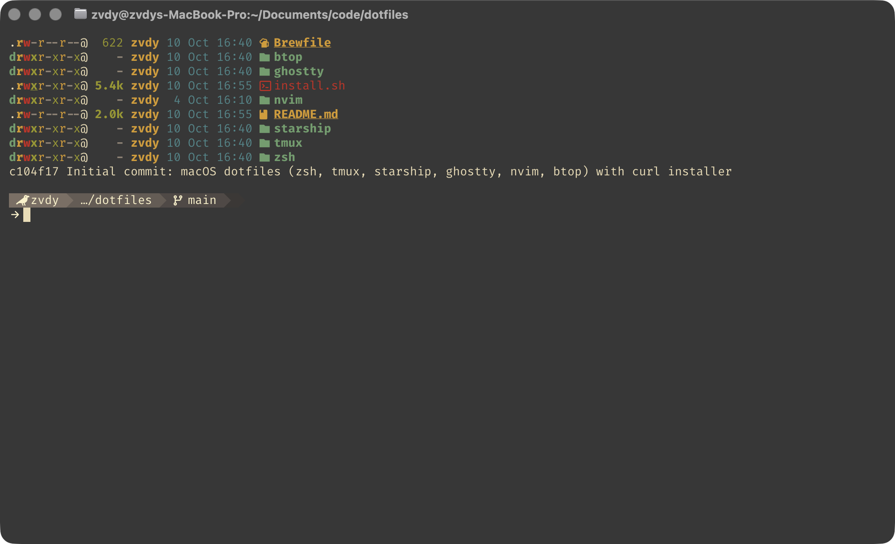
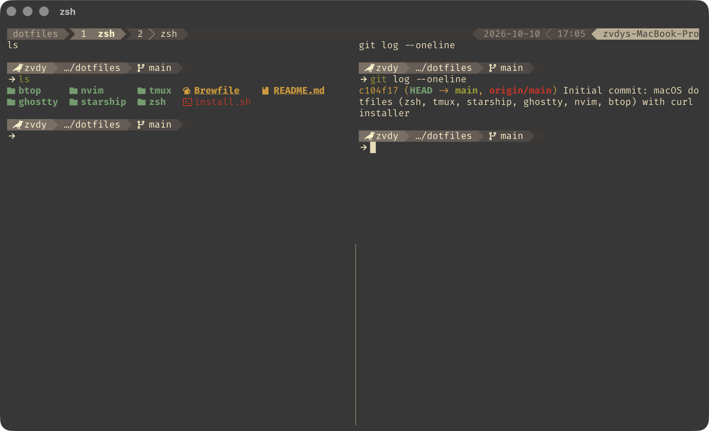
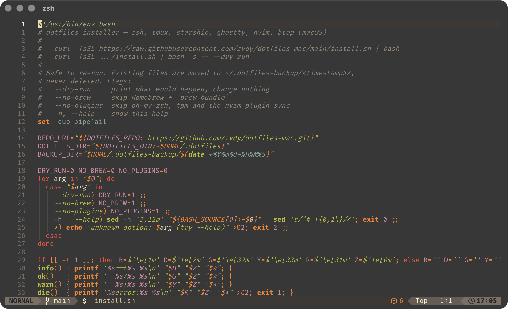
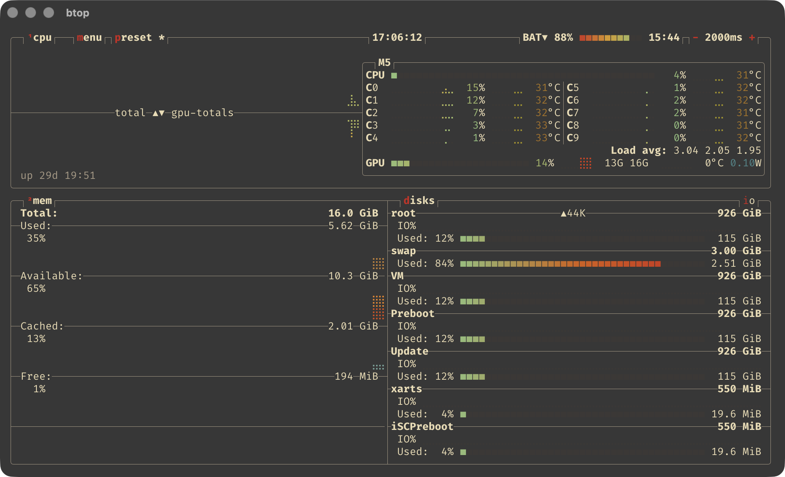

# dotfiles-mac

macOS terminal setup, all in one Gruvbox (morhetz) bg/fg palette: no accent colors, angled prompt segments.

| Tool | Config | Notes |
| --- | --- | --- |
| zsh | `zsh/zshrc` | oh-my-zsh (git plugin), eza/bat/rg aliases, zoxide, fzf, `tn` / `tr` / `tls` tmux helpers |
| starship | `starship/starship.toml` | angled powerline prompt, bg-shade fade, no clock |
| tmux | `tmux/tmux.conf` | `Ctrl+A` prefix (status bar highlights when armed), mouse on, arrows resize |
| ghostty | `ghostty/config` | Gruvbox light/dark, `Cmd+A` sends the tmux prefix |
| nvim | `nvim/` | LazyVim, gruvbox hard, transparent |
| btop | `btop/btop.conf` | |

## Screenshots

| | |
| --- | --- |
|  |  |
| starship prompt in Ghostty | tmux status bar and splits |
|  |  |
| LazyVim, gruvbox hard | btop |

## Install

```sh
curl -fsSL https://raw.githubusercontent.com/zvdy/dotfiles-mac/main/install.sh | bash
```

Preview first, change nothing:

```sh
curl -fsSL https://raw.githubusercontent.com/zvdy/dotfiles-mac/main/install.sh | bash -s -- --dry-run
```

Or clone and run it yourself:

```sh
git clone https://github.com/zvdy/dotfiles-mac ~/.dotfiles && ~/.dotfiles/install.sh
```

The installer:

1. clones the repo to `~/.dotfiles` (skipped when run from a checkout)
2. installs Homebrew if missing, then everything in the `Brewfile`
3. symlinks each config into place; **existing files are moved to `~/.dotfiles-backup/<timestamp>/`, never deleted**
4. clones oh-my-zsh and tpm, installs tmux plugins, syncs nvim plugins

Flags: `--dry-run`, `--no-brew`, `--no-plugins`. Safe to re-run.

## Keys worth knowing

- tmux prefix: `Ctrl+A` (`Cmd+A` in Ghostty). Then `c` new window, `|` / `"` split, arrows resize (repeatable), `h j k l` move focus. Mouse works too.
- `tn [name]` new window (or start a session), `tr <name>` rename window, `tls` session picker.

## Customize

Fork it and set `DOTFILES_REPO=https://github.com/<you>/dotfiles-mac.git` when running the installer, or edit `REPO_URL` at the top of `install.sh`.

`tr` shadows the coreutils `tr` in interactive shells; use `command tr` for the real one.
